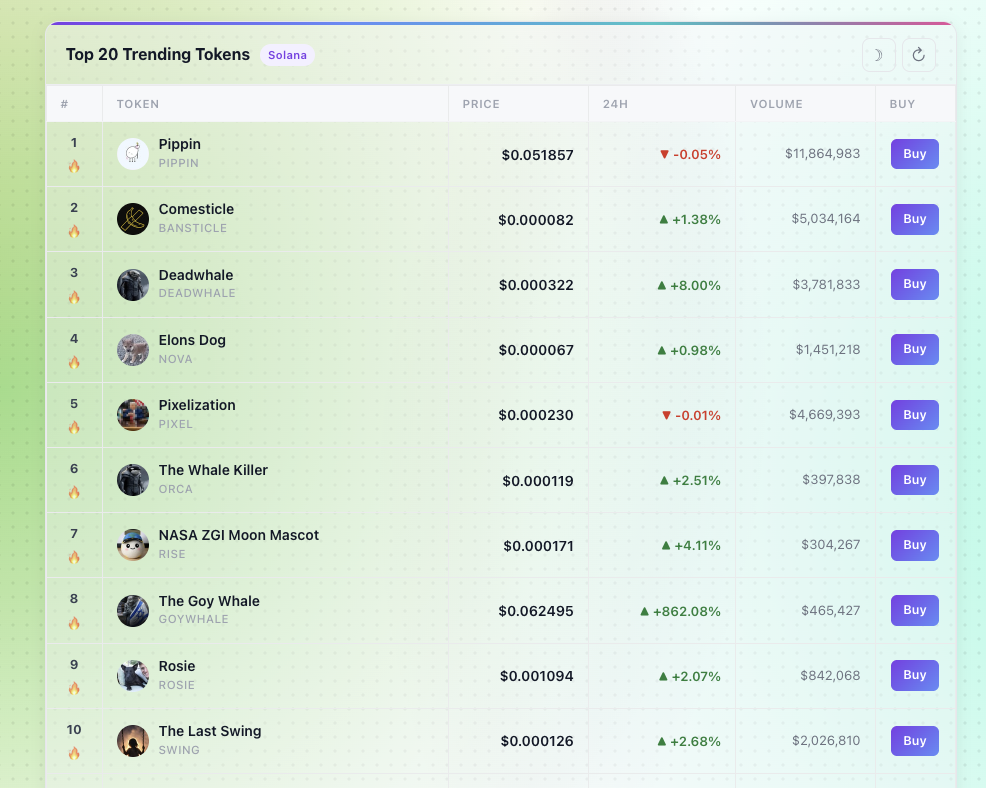

# MoonPay Trending Tokens

A WordPress plugin that displays the top trending crypto tokens powered by the [MoonPay Agents API](https://agents.moonpay.com), with live price data, 24h change, volume, and direct buy links.



## Features

- Top 20 (up to 50) trending tokens for any supported chain
- Live price, 24h change %, and volume data
- Click any token row to open a detailed modal (Solana tokens powered by Jupiter)
- Direct "Buy on MoonPay" button per token
- Light / dark mode toggle (respects OS preference, persists via localStorage)
- Auto-refresh on a configurable interval via AJAX
- Transient caching to minimise API calls
- Shortcode + sidebar widget

## Supported Chains

Solana · Ethereum · Base · Polygon · Arbitrum · Optimism · BNB · Avalanche

## Requirements

- WordPress 6.0+
- PHP 8.0+
- MoonPay publishable key (for buy buttons)
- MoonPay access token (optional — raises rate limit from 5 to 60 req/min)

## Installation

1. Upload the `moonpay-top20` folder to `wp-content/plugins/`
2. Activate the plugin via **Plugins → Installed Plugins**
3. Go to **Settings → MoonPay Top 20** and enter your credentials

## Configuration

| Setting | Default | Description |
|---|---|---|
| MoonPay Publishable Key | — | Enables the "Buy" button. Found in your MoonPay dashboard. |
| MoonPay Access Token | — | Optional. Obtain via `mp login` / `mp verify`. Raises rate limit to 60 req/min. |
| Chain | `solana` | Chain to fetch trending tokens for. |
| Number of Tokens | `20` | How many tokens to display (1–50). |
| Widget Title | `Top 20 Trending Tokens` | Heading shown above the list. |
| Cache / Refresh Interval | `300` | Seconds to cache results (min 60). |

## Usage

### Shortcode

```
[moonpay_top20]
```

Override defaults with attributes:

```
[moonpay_top20 chain="ethereum" limit="10" title="Hot Tokens"]
```

### Shortcode Attributes

| Attribute | Default | Description |
|---|---|---|
| `chain` | Settings value | Chain to display (`solana`, `ethereum`, `base`, etc.) |
| `limit` | Settings value | Number of tokens (1–50) |
| `title` | Settings value | Widget heading |

## API

Trending data is fetched from the MoonPay Agents API:

```
POST https://agents.moonpay.com/api/tools/token_trending_list
```

Token detail modals (Solana only) are powered by the Jupiter Lite API.

Buy links use the MoonPay widget:

```
https://buy.moonpay.com/?apiKey=<key>&currencyCode=<code>
```

## License

GPL-2.0-or-later
